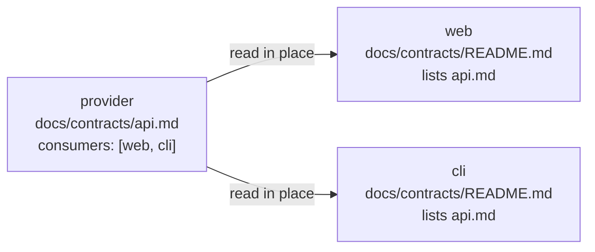

# Provider-Owned Contracts

Write down each interface between repos once, in the repo that provides it, and have every consumer read it there.

## Problem

Where two repos meet (an API one serves and another calls, a build one runs on the other's output, a content format one writes and the other parses) each side relies on things the other could change. Without a written agreement, an agent changing one side can't tell what the other relies on, and finds out when something downstream breaks.

The obvious fix, describing the interface in both repos, or copying the provider's description into each consumer, gives two versions that drift apart. A sync that keeps the copies current only proves the consumer holds the latest text, not that its code still meets it. What a change to an interface needs is someone checking each consumer against it.

## Solution

- **The provider owns the contract.** It lives in the provider's `docs/contracts/`, one file per interface, with front matter naming the provider and its consumers. It states what each side relies on, the tests that enforce it, and how to change it safely. It changes in the same PR as the code it describes, and before any consumer relies on the change.
- **Consumers read it in place**, in the provider's checkout beside them, fetched to the latest `main`. There are no copies. Each repo's `docs/contracts/README.md` lists what it provides and what it depends on, by provider and path, so the front matter and the READMEs together form the graph a change follows.
- **Whoever changes a contract reconciles it.** Changing one you provide means checking each consumer it names, in the same piece of work, and changing any that no longer holds. Relying on something new from another repo means reading its contract first, and changing the provider before the consumer. The rule goes in every repo's `AGENTS.md`.
- **References between repos are plain text**, by repo and path. A relative link from one checkout into another works on disk and breaks on GitHub.
- **Systems outside the project get external contracts**, owned by the repo that relies on them, in `docs/contracts/external/`: what it relies on from the registrar, the cloud accounts, the Git host or the mail provider, how that side is set up by hand, how to check it, and what breaks. Nothing tests the other side, so each says how to check it.



## When to Use

- Two or more repos depend on each other through an interface either side could break
- Agents work in one repo at a time, and need to know what the others rely on
- The repos are checked out side by side, or in a [meta repo](../meta-repo/README.md)'s workspace, which can check they are

## Directory Structure

```
<repo>/
├── AGENTS.md                      # carries the reconciliation rule
└── docs/
    └── contracts/
        ├── README.md              # what this repo provides, and what it depends on, by provider and path
        ├── <interface>.md         # one per interface this repo provides
        └── external/
            └── <system>.md        # one per outside system this repo relies on
```

## Setup

1. For each interface a repo provides, copy `template/docs/contracts/example-contract.md`, name the consumers in its front matter, and fill in each section. Start from the tests: a contract with nothing under "Enforced by" is a wish.
2. In every repo, copy `template/docs/contracts/README.md` and list what it provides and what it depends on.
3. For each outside system a repo relies on, copy `template/docs/contracts/external/example-system.md`.
4. Add the rules in `template/AGENTS-rules.md` to each repo's `AGENTS.md`, or to a section every repo shares, such as a meta repo's system map.
5. Make sure sessions have the providers checked out. The meta repo pattern's session-start check reports a missing or shallow repo; without it, say in `AGENTS.md` where each sibling is and how to clone it.

## Template Files

| File | Purpose |
|---|---|
| `template/docs/contracts/README.md` | The index: how contracts work in this repo, and the table of provided and depended-on contracts |
| `template/docs/contracts/example-contract.md` | A contract: front matter, what it covers, the contract itself, what enforces it, how to change it |
| `template/docs/contracts/external/example-system.md` | An external contract: what this repo relies on, how it's set up by hand, how to check it, what breaks |
| `template/AGENTS-rules.md` | The rules to add to `AGENTS.md`: read at the source, provider first, reconcile consumers |

## Tradeoffs

- **A change is only as well reconciled as whoever makes it.** Nothing detects a provider-side edit that skipped its consumers; the consumers' own tests and the build remain the backstop. If that drift happens, each consumer can record the provider commit it last checked a contract against, and a session-start check can compare it with the provider's `main`.
- **The provider has to be checked out.** A tool that sees only one repo, such as a reviewer on one repo's pull requests, can't read the contracts it depends on. Copies would cover it, at the cost of a second version of each contract.
- **Contracts are prose.** "Enforced by" points at the tests that keep each one true; whatever isn't tested is kept true by review.
- **External contracts are checked by hand.** Each says how, and they go stale quietly if no one does.
